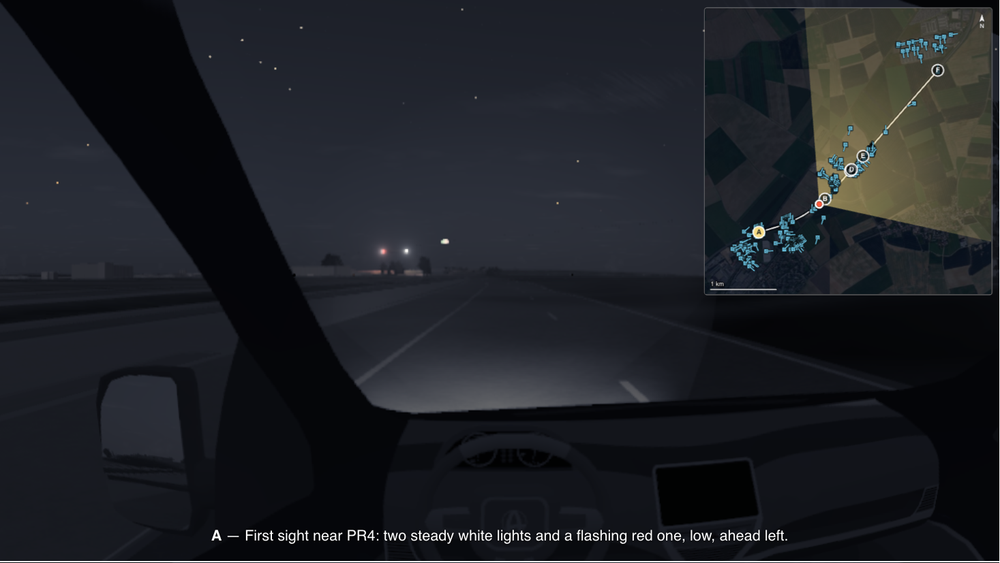
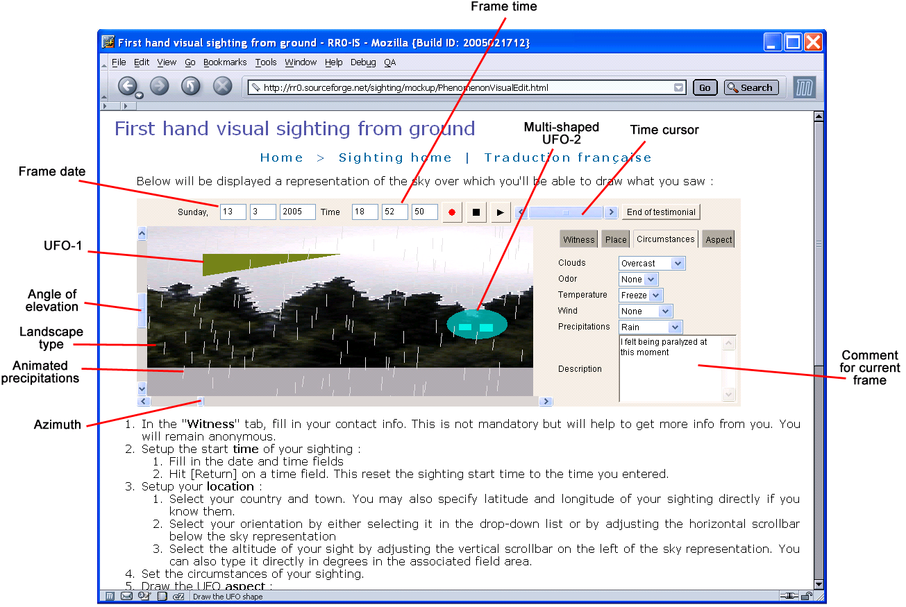
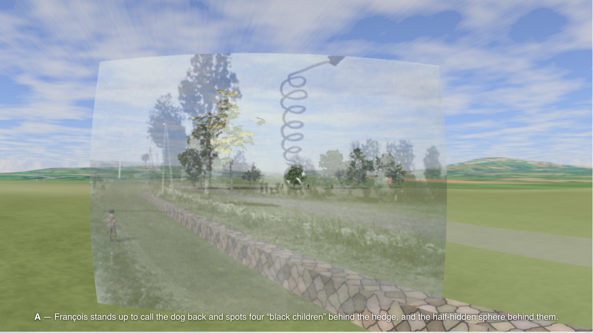
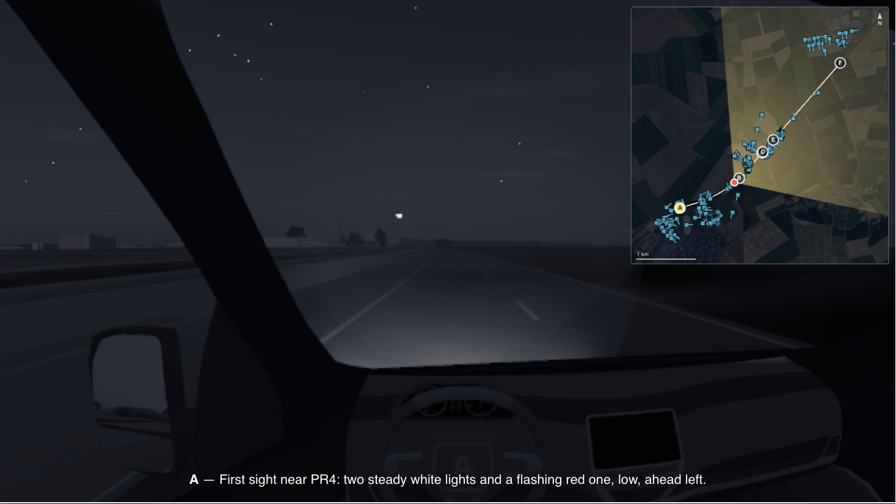
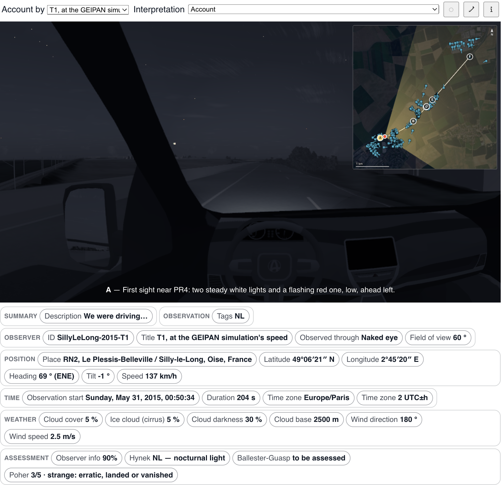

# Replaying the sky of a UFO sighting

*Testing every interpretation against what can be checked*

*Silly-le-Long (France), 31 May 2015, 00:50: what the driver of a gendarmerie patrol described, replayed under the sky of that night, on the road he was driving. This is not a video: the scene is computed in the browser.*

For 25+ years now, I've been maintaining the [RR0](https://rr0.org) website, which collects UFO cases along with whatever can be found about them: testimonies, investigations, documents and the analyses that were made of them. In previous articles I discussed how [UFO data is aggregated](https://medium.com/@rr0/aggregating-ufo-data-1fece059fcb0) and why [so many UFO databases](https://medium.com/@rr0/why-so-many-databases-185b60a9cae7) keep being created. This one is about another project of mine, older than all of those articles and just rewritten from scratch: [UFO@home](https://ufoathome.org).

UFO@home lets a witness **draw** what they saw, **record** how it moved, and **replay** it against the sky, weather and place of the observation. Not an artist's impression: a reconstruction anyone can check.

## The problem

Most of what we know about a UFO sighting is a **testimony**. A testimony is precious, but it is also the weakest kind of data: the words of someone who saw something once, for a few seconds, without expecting it, and who describes it with what they know.

So the debate usually turns to the witness. Are they credible? Are they sincere? Could they have been mistaken? In 2007, I [wrote about](https://medium.com/@rr0/cest-l-histoire-d-un-t%C3%A9moin-e8517bc2b627) how this leads nowhere: you tell the witness it was a balloon, they reply that it looked nothing like a balloon, and you end up concluding on your own conviction, against the only piece of evidence you have. Sincerity is not the question either: someone can be perfectly sincere and still wrong.

That article suggested another way (translated from French):

> In a decor reproducing as faithfully as possible the conditions of the observation (place, time, weather, surroundings), show your hypothetical balloon as it would have appeared, and ask the witness whether it looks like what they saw.

If they say yes, the hypothesis has made a real step, by **agreeing** with the testimony instead of overruling it. If they say no, think of something else or suspend your judgment.

This was not a new idea. Back in 1968, in a statement to the UFO symposium of the US House Committee on Science and Astronautics, psychologist [Roger Shepard](https://rr0.org/people/s/ShepardRogerN/) [argued](https://rr0.org/time/1/9/6/8/07/29/Symposium/Shepard/) that our **powers of recognition exceed our powers of description**, and that a fleeting event would be better reconstructed the way police build a composite sketch with a witness: by showing and adjusting, not by asking for words. He also noted that when witnesses say something was "the size of a football", they mean its *apparent* size. We will come back to that.

## A short history

The project started in 2003 as a second, dynamic generation of RR0. The sociologist [Pierre Lagrange](https://rr0.org/people/l/LagrangePierre/) suggested to turn it into a tool for visual testimony, along the lines of Shepard's recommendations, and it became **UFO@home**.

*The 2005 mock-up of the Java applet: draw the UFO's shapes over a picture of the sky, move them along a time cursor, describe the circumstances.*

It was a Java applet: you could draw a shape, record it and play it back. In 2005-2006, the data side of the project left to become [Archipelago](https://github.com/RR0/Archipelago), a meta-database for UFO databases that each have their own format. In 2008, finding no realistic reproduction of the sky for a given place, date, time and heading, I worked on a Java port of the Stellarium planetarium, which never became usable on the web.

The applet then slept for many years. In 2026, UFO@home was rewritten from scratch in TypeScript, as web components anyone can [put on their own site](https://ufoathome.org/docs/), and it now has [its own site](https://ufoathome.org).

## First principle: contextualise

The first principle is to reproduce **what can be checked** about the place and the moment, as faithfully as it can be reproduced. The witness provides the phenomenon; nothing else is left to memory.

- **The sky**: the Sun, the Moon and its phase, the planets, the stars, the Milky Way, placed by ephemeris for that instant and that place, and drawn only as far as the witness's eye could see them.
- **What else was up there**: comets, novae, meteor showers, satellites, re-entries and real air traffic, each drawn only if it could have been visible from there, then.
- **The weather that day**, from an hourly worldwide reanalysis going back to 1940: cloud layers, rain, snow, storms and wind.
- **Atmospheric optics**: haloes, sundogs, pillars, rainbows, computed from the refraction of ice and water rather than stored.
- **The ground**: real relief and aerial imagery, roads, buildings, trees, streetlights, vehicles and other witnesses.
- **The instrument**: an eye is not a camera lens, and an Instamatic is not a phone. The device decides what could be recorded at all.

Every source is **named** where its data is used and can be swapped for another one, so that what the scene claims can be checked.

A computed scene can still be wrong in ways nobody notices. This is why a **photograph of the place** can be laid over the render: aligned on a few landmarks, it shows what the relief does not know, and gives back the heading the witness actually faced as a measurement.

*[Cussac](https://rr0.org/science/crypto/ufo/enquete/dossier/Cussac/) (France), 29 August 1967: a photograph of the place laid over the render, and the widening helix of the sphere's departure. Every angle comes from the GEPAN's theodolite survey of 1978.*

## Second principle: bound the hypotheses

The second principle is to narrow down what the phenomenon can have been, from what is known with enough certainty and from what the witness reports, **without taking on the witness's own interpretation** of it.

Nobody perceives metres. A witness perceives an **angle**: the thing covered a thumbnail at arm's length, or two full Moons. "About thirty metres long" is a conclusion drawn from a distance that could not be perceived either, and the two errors multiply. Shepard's football again.

So a UFO@home recording stores how big the phenomenon **looked**, in degrees, and no real size or distance anywhere. Metres come back in one case only: when the phenomenon was seen to pass in front of or behind something whose position is known. That is an inequality, and the tool reports it as one, including, most of the time, "unknown".

For the same reason, the phenomenon is drawn as a **flat shape on the witness's field of view**, not as a solid body placed in space. Assuming a craft at a distance is already an interpretation, and it quietly rules out the explanations that matter most: a halo, a planet, a satellite, an aircraft's landing light. And since two people a hundred metres apart did not see the same thing, a case with several witnesses is **several recordings**, one per witness.

Then interpretations can be tested, **all of them**, in the same scene. Here is the same second of the Silly-le-Long drive, replayed with the reading of the [GEIPAN](https://rr0.org/org/eu/fr/cnes/geipan/), the French official UFO office, which identified a light aircraft on final approach:

*The same second, through the [GEIPAN's reading](https://rr0.org/science/crypto/ufo/enquete/dossier/SillyLeLong/): a Cirrus SR20 on final approach, whose "pivot effect" would keep it pinned to one spot as both close in. Switching readings is one menu in the player.*

The point is not to decide in the witness's place, nor to dismiss them. It is to **show** what each hypothesis would have looked like, from where they were, at that moment. Some hypotheses fit what was really overhead. Some are ruled out by the sky itself. And some, like this one, fit in part and leave a gap with what the driver described, which then has somewhere visible to live.

## Everything stated, everything checkable

A reconstruction is only as good as what it is made of, so nothing in it is hidden. Under the picture, every value the recording states is shown, from the place and time zone to the cloud base and the assessments of the case:

*Each chip is a statement of the recording: the witness's position, heading and speed, the time, the weather, and the assessments of the case on several scales (Hynek, Poher, Ballester-Guasp).*

Many of those values were not given by the witness: they were looked up, estimated or assumed. The format records which is which, with its source, as we will see in [the next article](URL_OF_ARTICLE_2).

## Two uses

UFO@home is meant for two kinds of people.

- **Witnesses** can [describe their own sighting](https://ufoathome.org/edit/): draw what they saw, record how it moved, say when and where, and the sky of that moment appears behind it. Correct it until it matches. What you get is a file that is yours: there is no account and nothing is uploaded.
- **Investigators and authors** can put a reconstruction in an article, a case file or a report, with two lines of HTML, on their own site and under their own name. UFO@home is [free software](https://github.com/RR0/UfoAtHome) under the MIT license: use it, change it, redistribute it, fork it.

The [demos](https://ufoathome.org/demos/) currently hold 41 reconstructions, from classic cases (Chiles & Whitted, Socorro, Valensole, McMinnville, Trans-en-Provence) to what the sky alone can show: a re-entry, a Starlink train, a nova, a halo photographed with a phone.

## Conclusion

UFO@home tries to move the UFO debate from the witness's credibility to what can be checked:

- **contextualise**: reproduce the sky, the weather, the ground and the instrument of that place and moment, with every source named;
- **record angles, not sizes**: store what the witness could actually perceive, and let distances come back only as inequalities;
- **test every interpretation**, the witness's as well as the others, in the same scene, instead of ruling by conviction;
- **share**: a free, embeddable tool and an open file format, so that anyone can check, correct or contest a reconstruction.

The next articles will describe how it is designed: first the [model](URL_OF_ARTICLE_2) behind a reconstruction (cases and observations, decor and phenomena, sources and approximations, assessments, privacy), then its [architecture](URL_OF_ARTICLE_3) (assets and providers, the web and offline use), then how [interviews](URL_OF_ARTICLE_4) are kept and linked to the observation, and finally how [AI](URL_OF_ARTICLE_5) can help write a recording, without being required.

---

*The UFO@home series:*

1. [Replaying the sky of a UFO sighting](URL_OF_ARTICLE_1): why, and the approach
2. [What a UFO reconstruction states, and on what](URL_OF_ARTICLE_2): the model
3. [Built to outlast its sources](URL_OF_ARTICLE_3): providers, assets, the web and offline use
4. [What the witness said, and where it shows](URL_OF_ARTICLE_4): interviews
5. [AI writes the account, never the sky](URL_OF_ARTICLE_5): AI, and why it is optional
