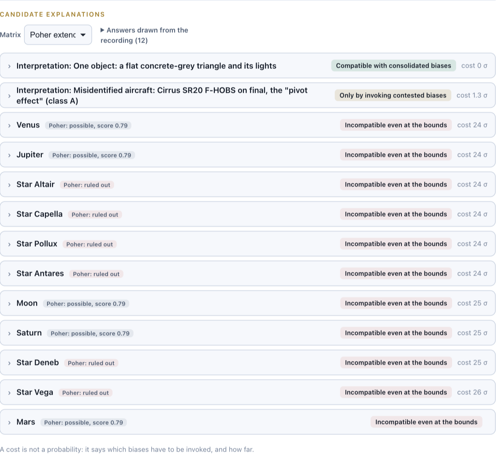
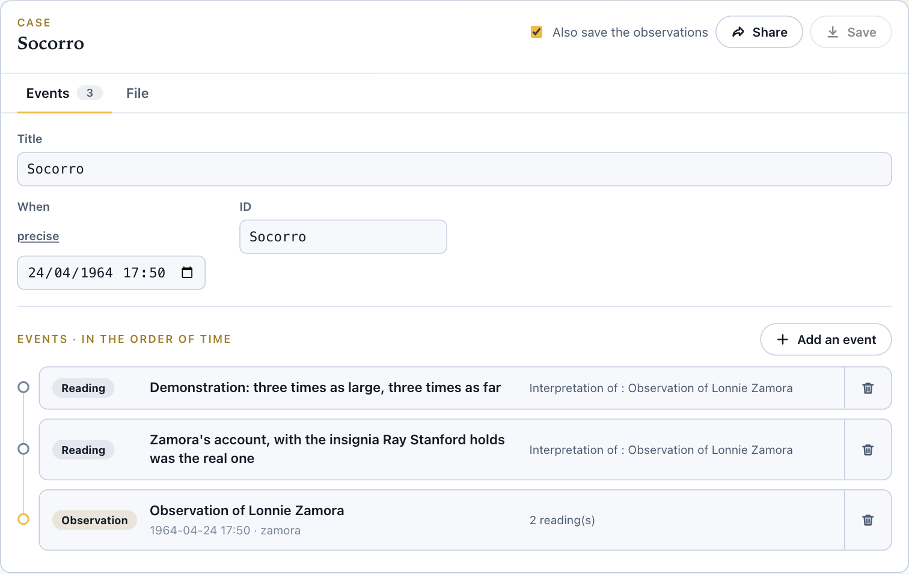
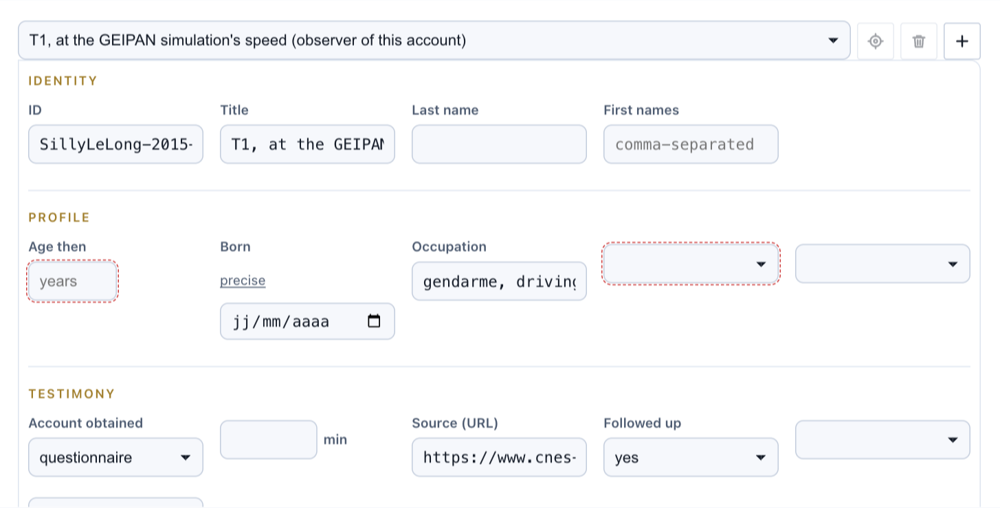
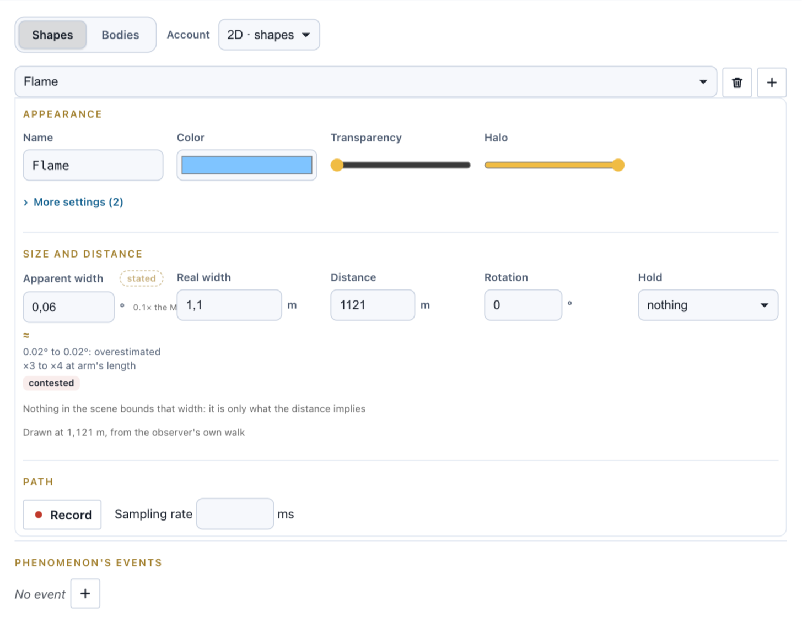
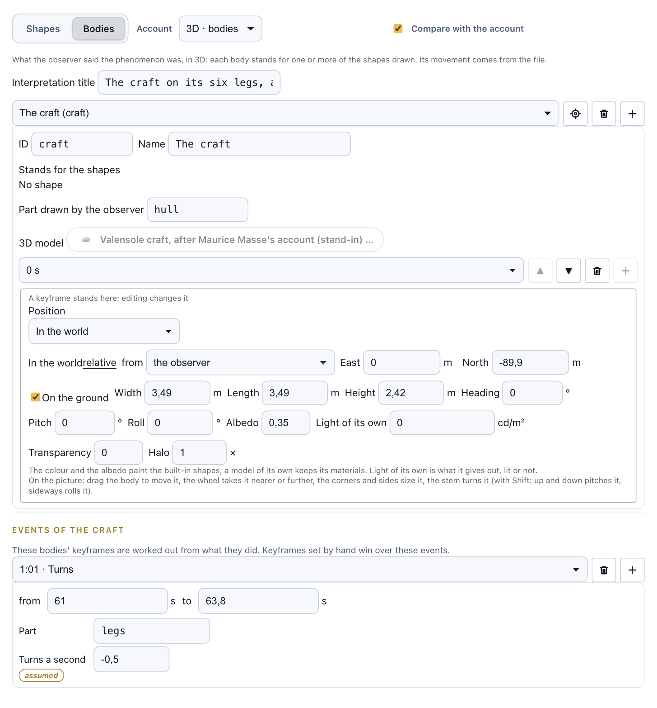
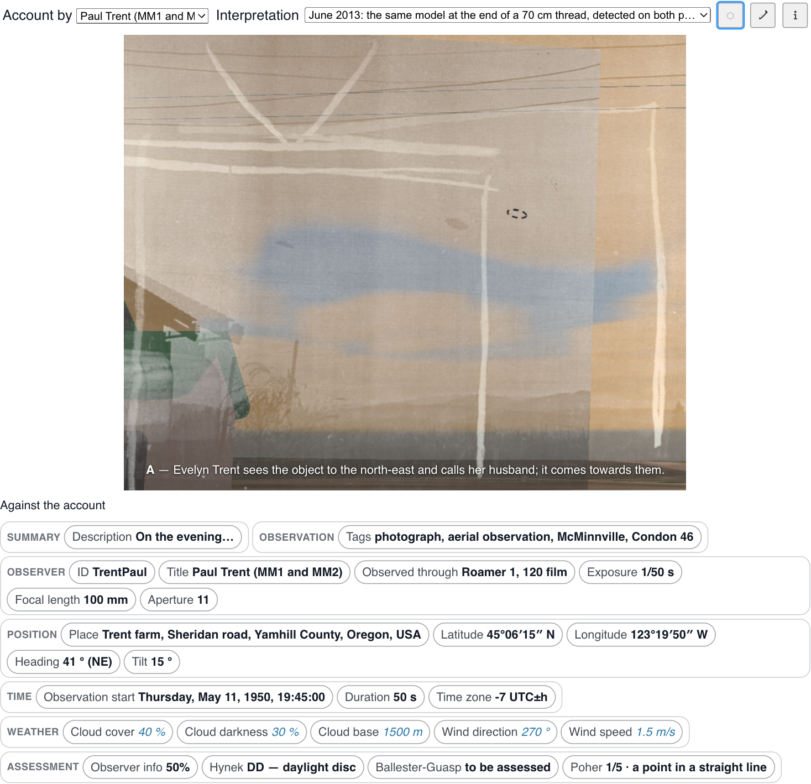
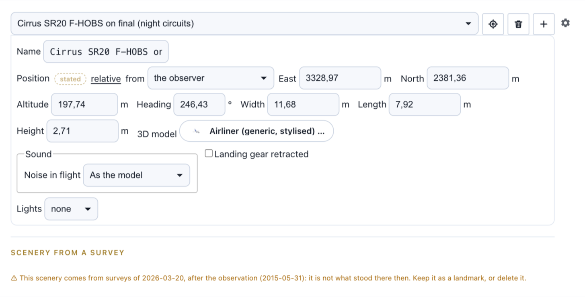
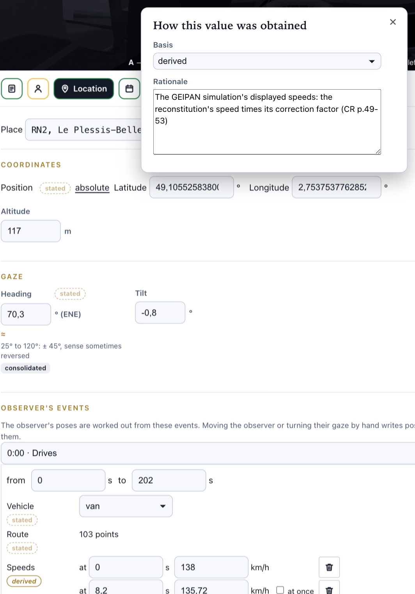
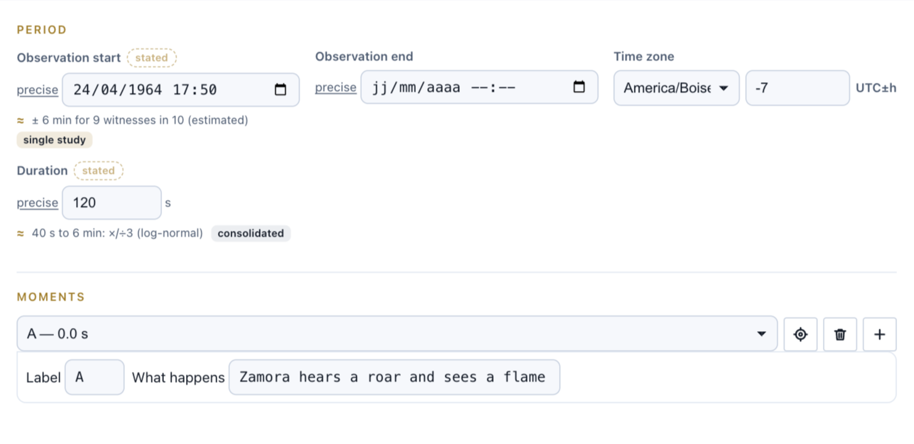

# What a UFO reconstruction states, and on what

*The model behind UFO@home*

*Silly-le-Long, 31 May 2015: every candidate of that sky held against the account, within what is known of observers' errors. "A cost is not a probability: it says which biases have to be invoked, and how far."*

In the [previous article](URL_OF_ARTICLE_1), I introduced [UFO@home](https://ufoathome.org), a free tool that replays a UFO sighting against the real sky, weather and place of the observation, so that every interpretation, the observer's as well as the others, can be tested in the same scene.

A scene is only as good as what it is made of. This article is about **what a reconstruction is made of**: the concepts it is split into, what each of them states, and on what grounds. No code here: this is about the domain, and about a few choices that may matter to anyone collecting UFO data, whatever their tool.

## A case is not an observation

The first split is between the **case** and what happened in it. A case is what an investigation is about: a night, a place, a title. It does not describe the event itself: it lists what happened around it, as **events**, each a document of its own.

UFO@home knows three kinds of events:

- **observations**: the account of one observer, which is what gets replayed;
- **interpretations** (or readings): an explanation of an observation, a kite, a planet, an aircraft, a hoax;
- **interviews**: a conversation held with an observer, which fixes what they said when asked.

*The Socorro case (1964): one observation, and two readings of it. Each event is a file of its own, and the readings name the observation they interpret.*

Events refer to each other. An interpretation names the observation it explains, an interview the observer it was held with, and a passage of an interview can point at the moment of the observation it tells about, so that the observation then lists, at that moment, what was said of it.

Everything else a case may hold (its classification, its sources) belongs to the database the case lives in, such as [RR0](https://rr0.org), and passes through unread. A case can start as a single observation and grow.

## An observer, not a witness

Most UFO literature speaks of **witnesses** and **testimonies**. UFO@home speaks of **observers** and **accounts**, for two reasons. An observer may be a person *and* their devices: a camera, a phone, a dashcam. And "testimony" already suggests a court, a verdict to come, which is precisely what a reconstruction does not deliver.

This is not only vocabulary. **Each observer has a recording of their own.** Two people a hundred metres apart did not see the same thing, and when their accounts disagree, the disagreement has to be kept, not averaged. A case with three observers is three recordings, and the player switches from one to the other.

An observer may be named, given as initials, or left anonymous. What matters to the reconstruction is where they stood, how they moved and where they looked, along with what is known of them and of how their account was obtained:

*What is known of the observer, and of how their account was obtained (here, a questionnaire, with its source): what assessments will later need.*

An observer's movement is a **track** of poses over time (position, heading, tilt, field of view) or, more simply, a list of **events** they went through: they drove along a road at given speeds, looked in the mirror, turned their head to follow something. The player works the poses out of them.

## What was seen: a phenomenon, in angles

What the observer saw is called a **phenomenon**, never an object. A tool that names an object has already concluded there was one, and silently ruled out every explanation where there was none: a halo, a planet, a satellite, a landing light.

A phenomenon is drawn as one or several **shapes** (ovals or polygons), each with a colour, a transparency, a halo, a brightness and a blur, keyframed over time. And a shape is placed by **angles only**: where it was in the observer's sky (azimuth and elevation), and how big it **looked** (its apparent width and height, in degrees). No real size and no real distance are stored anywhere.

*An apparent width of 0.06°, stated by the observer. A real width can be typed, but the editor says what it is worth: nothing in the scene bounds it, it only follows from an assumed distance.*

Metres come back in one case only: when the observer said the phenomenon passed in front of or behind something whose position is known, a tree, a hill, a building. That is an inequality, and it is reported as one.

## And what it was: bodies, in 3D

The flat shapes of an account are what reached the observer's eye. An **interpretation** is a claim about what that was, so it is made of **bodies** in metres: a craft on its legs, a balloon, a Cirrus SR20 on final approach, a model hanging from a thread. Each body states which shapes of the account it explains.

*Valensole (1965): the observer's own reading, drawn in 3D as the observer described it. Note the "assumed" mark on the rotation of the legs: nothing in the account gives it.*

Bodies are tested the hard way: placed in the scene, they cast shadows, the ground can hide them, and their outline is measured from where the observer stood against what the account says at every instant. The player can draw the account's shapes over an interpretation as dashed outlines, and say how far off the direction is and how many times wider each body looks.

*McMinnville (1950), compared with the 2013 reading by Cousyn, Louange and Quick: the account's shape as a dashed outline, beside the model on its thread.*

The observer's own reading lives in their recording. **Someone else's reading is not part of the account**: it is another observation, the one that took place as its author holds it, with its own recording, its date, its author, and the observation it reads. This keeps an investigator's conclusion from silently overwriting what the observer said.

## Decor, and the sky's own events

Around the observer there is a **decor**: buildings, trees, streetlights, vehicles, other people. A decor object outlasts the observation, and is placed from where it stood, at the height it stood. A lot of it can be fetched from open data, which raises a question the editor does not let slip:

*Scenery fetched from a 2026 survey for a 2015 observation: "it is not what stood there then. Keep it as a landmark, or delete it."*

Some things are neither decor nor interpretation: a laser beam, a rocket launch, a re-entry. They happened whether anybody saw them or not, so they are stated as **sky events**, facts of the moment with their own sources, which the scene draws as the physics says they looked from there.

## Where each value comes from

This may be the most important part of the model. **Any value of a recording can carry its basis**, among four:

- **measured**: read off an instrument, by the observer or an investigator (a clock, a compass, an arm's-length gauge, a theodolite on site);
- **stated**: the observer said it (the default, so that a plain value means what it always meant);
- **derived**: worked out from what the observer said plus something checkable (a road's width, a map, a measured drawing), with the working written down;
- **assumed**: chosen so that the reconstruction has a value at all, on nothing the observer said.

*The van's speeds are not what the driver said: they are derived from the GEIPAN's own simulation, and the rationale says how, with a page reference.*

The list of assumed values is the list of what to go back to the observer or the file for. And a basis expires: when someone types over an assumed value, it no longer claims to be a guess.

## Approximations, allowed and said

An account is rarely precise, and refusing imprecision produces either nothing or false precision. So the format accepts **approximate values, and says they are approximate**. Dates are written in [EDTF](https://www.loc.gov/standards/datetime/), the extended date format of the Library of Congress: "around 1954", "June 2025, uncertain", "a year of the 1990s", "the spring of 2022", or "05:00" alone for a time of day remembered without its date. A duration can be "about ten minutes" or "five to ten minutes".

Another rule matters as much: **absent is not zero**. No sound in a recording means nobody asked the observer; "none" means they said they heard nothing. The same distinction runs through the weather.

## The limits of testimony, included

An account is not only imprecise: it is biased, and the biases are known. Decades of studies, from the Condon report to the GEPAN's technical notes and more recent research, say how observers err, and the errors are rarely a symmetric margin. Elevations are overestimated. A low light is placed at the distance of the skyline. Apparent sizes recalled at arm's length are overestimated three to four times, a figure other studies dispute. Durations are off by a factor of three either way.

UFO@home keeps those **laws of error** beside the values they apply to, each with the status of what supports it: *consolidated* (several independent studies), *single study*, *argued* or *contested*.

*Socorro: each stated value comes with what is known of its error and how solidly it is known. The "precise" buttons give each date its EDTF qualifier.*

They are what the candidate explanations at the top of this article are computed with. Each candidate the sky offers at that moment (the Moon, the planets, bright stars, satellite passes, re-entries, recorded fireballs, aircraft of the traffic record, and the readings of the case) is confronted with the account. It is then said to be compatible with consolidated biases, compatible only by invoking contested ones, or incompatible even at the bounds of the laws, together with the biases it needs and how far.

None of this decides for anyone. But it turns "it was probably Venus" into a statement that can be checked, and "it could not have been Venus" too.

## Assessments, as others defined them

UFO research has its own ways of rating a case, and UFO@home implements several of them as **assessors**, each faithful to its author and saying where it departs:

- **J. Allen Hynek's classification** (nocturnal light, daylight disc, close encounters…), which a recording can decide for four of its six classes. The other two need a physical trace or a radar, which the format cannot state, so it says so rather than guess.
- **Claude Poher's strangeness rating** (1969), from 0 to 5, read from the facts the account describes and never from the observer.
- **The Ballester-Olmos and Guasp score** (1981), the product of the account's information quality, its strangeness and its reliability. When the recording does not say how the account was obtained, or nobody has judged its strangeness, it shows "to be assessed" rather than a zero that would read as a verdict.
- **A coverage profile** of what a reconstruction needs to settle before it can be replayed at all (when, where, facing which way, how big it looked, where in the sky…): a fixed list, so that two recordings can be compared.

Every criterion says where in the recording its answer was found, and with the **weakest basis** of the values it rests on: an answer is worth no more than the least of what holds it up.

## Privacy

Finally, a reconstruction is about people, so the model is careful about what it reveals. A recording names an observer only if they agreed or published their account themselves; otherwise initials do. When saving, the editor shows what a recording names or locates (a name, an address, an e-mail, a phone number) and offers to write names as initials, without deciding for its author. A precise place and date can identify a person even without a name, which is why a place can be made less precise too.

As for the tool itself: no account, no cookie, no tracker, nothing uploaded. A recording exists in the browser until it is saved, and what is saved is a file that belongs to its author.

## Conclusion

The model of UFO@home tries to make a reconstruction **say what it claims, and on what**:

- a **case** lists events (observations, interpretations, interviews) instead of merging them;
- one **recording per observer**, and someone else's reading is another recording, never an edit of the account;
- the **phenomenon** is stated in angles, as it reached the eye, and **bodies** in metres are claims tested from the observer's place;
- every value can carry its **basis** (measured, stated, derived, assumed) and its **approximation**, and absent is not zero;
- the **known errors** of observers are part of the model, with the status of their evidence, and they bound which candidates are reachable;
- **assessments** are delegated to the published methods, each saying where its answers come from;
- **privacy** is a property of the files, not a promise of a server, since there is none.

The next article will describe how the tool is built to grow: its **assets and providers**, which let anyone add a data source, a model or a catalogue, and why it is a web tool that also works offline.
