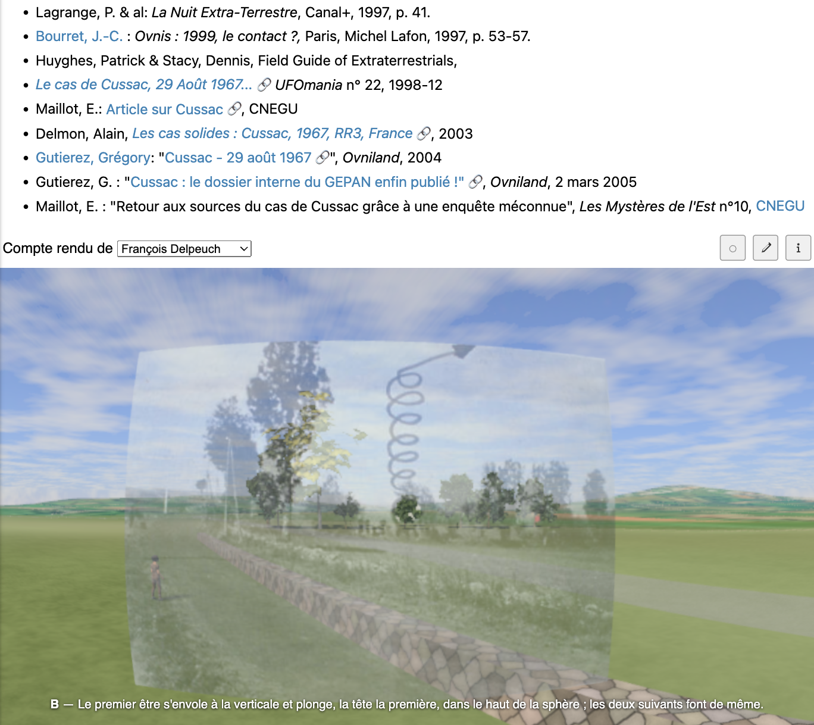
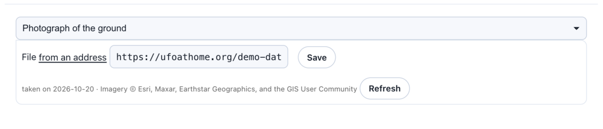
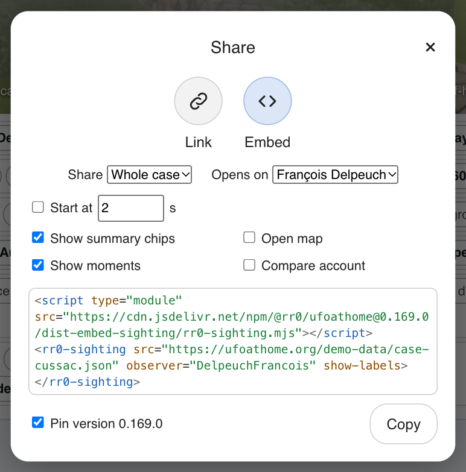

# Built to outlast its sources

*Providers, assets, and why UFO@home is a web page*


*The [Cussac](https://rr0.org/science/crypto/ufo/enquete/dossier/Cussac/) case file on rr0.org: an encyclopedia page, written in French, with the reconstruction embedded in it like a video.*

[UFO@home](https://ufoathome.org/) is a tool that [replays a UFO sighting](https://medium.com/@rr0/replaying-the-sky-of-a-ufo-sighting-d51db4e2742c) against the real sky of its date and place, from [what its reconstruction states](https://medium.com/@rr0/what-a-ufo-reconstruction-states-and-on-what-d4cf4c133274). This article is about how it is built, without going into the code: what lets it be used anywhere, take in new data, and still play the same in twenty years.

That last point is not abstract. The first UFO@home was a Java applet, in 2003. Applets died with the browser plug-ins that ran them, and took the tool with them. A reconstruction that is meant to be checked years later cannot rest on a technology somebody else can retire, nor on a service that can close.

## Why the web

A reconstruction has to be **seen** to be discussed: in an investigator’s report, a forum thread, an encyclopedia page, an e-mail. The one medium that goes everywhere is a web page, and the one thing every page can hold is an HTML element. So UFO@home is a set of elements, and putting a reconstruction in a page takes two lines:

```html
<script type="module" src="https://ufoathome.org/lib/rr0-sighting.mjs"></script>
<rr0-sighting src="https://example.org/my-case.json"></rr0-sighting>
```

That is how the case files of [RR0](https://rr0.org/) show theirs: a static site, with nothing to build and no framework. The recording stays at its author’s address, on their host, under their name, and a link to the player opens it in the reader’s language (English, French, Spanish or Italian today).

The elements are **Web Components**, the browser’s own standard for custom elements, not the components of a framework. This has consequences worth spelling out:

- **they work in any page**: a static site, WordPress, a React or Vue application, a wiki, a hand-written HTML file;
- **there is nothing to build**: no bundler, no compilation step, no configuration;
- **there is nothing to keep up with**: no framework version to match, so nobody’s next major release can make them obsolete;
- **their insides are their own**: each keeps its markup and styles in a shadow root, so the host page’s CSS cannot break them, and they cannot break the page.

There are five of them: the **scene** (the phenomenon in the real sky, weather and ground), the **sighting** (the scene plus who saw it, the metadata and the sharing), the **sighting editor**, the **case editor**, and a **date input** that knows about imprecise dates. Each composes the one below it, so a page only ever writes one tag. The heavy parts that a page may never use, such as the editor of 3D bodies or the code that reads photographs, are only downloaded when they are first needed.

And nothing has to depend on ufoathome.org. The components are [published on npm](https://www.npmjs.com/package/@rr0/ufoathome) under the MIT license; anyone can copy the built files onto their own server and point the script there. A finished recording does not even need the third-party services to play: without them, the scene falls back to a plain horizon.

## Providers: every source is a choice

A reconstruction is made of other people’s data: the weather on record, the relief, the aerial imagery, the buildings, the place names, the time zone, the air traffic, the brightness of the night sky. Each of them goes through a **provider**: an interchangeable source, behind a common registry.

The registry exists for two reasons. The first is that **naming a source and letting it be chosen are the same act**. A static “© OpenStreetMap” tucked beside a field says where today’s answer came from, but hides that it is a choice; a picker with no attribution credits nobody. So the source is a picker, with the credit its licence requires beside it, shown where the data is reported.

The second is that **a second source can be added without touching the rest**. Today, for instance:

- the weather comes from the ERA5 reanalysis through [Open-Meteo](https://open-meteo.com/), hourly, worldwide, back to 1940;
- the relief from the French IGN’s LiDAR HD and RGE ALTI in France, and from AWS Terrain Tiles elsewhere;
- the aerial imagery from the IGN, [EOX Sentinel-2 cloudless](https://s2maps.eu/) or Esri World Imagery;
- the buildings from the IGN’s LiDAR and topographic database, or from OpenStreetMap;
- the place names from [Nominatim](https://nominatim.org/), the air traffic from [adsb.lol](https://adsb.lol/), the night sky’s brightness from the World Atlas of artificial sky brightness.

Some registries have a single entry, on purpose: the seam is in place before it is needed. The [assessment methods](https://medium.com/@rr0/what-a-ufo-reconstruction-states-and-on-what-d4cf4c133274) are a registry too, and so is the [language model that can draft a recording](https://medium.com/@rr0/ai-writes-the-account-never-the-sky-9e435229eb92).

A few rules go with them, which the site states for every source:

- **a source is read only when it is needed**: services are called only for a recording that needs them, and never for a date before their record begins;
- **measured beats modeled, and modeled beats assumed**: a brightness is a published observation when one exists, and a formula fills in only what nobody measured;
- **the limits are stated**: before 1940 for the weather, before 1957 for satellites, before February 2021 for individual satellite passes.

## Assets: what may disappear is hosted

Some data cannot be fetched live from a browser, or could be taken down by whoever publishes it. That data is copied once, reduced, credited, and served by the project itself as **assets**:

- the star catalogue ([HYG](https://github.com/astronexus/HYG-Database)), comets propagated from JPL Horizons, novae from the AAVSO’s light curves, the Moon’s relief from NASA’s LOLA;
- satellites from [CelesTrak’](https://celestrak.org/)s catalogue, and an archive of their orbital elements;
- atmospheric re-entries from The Aerospace Corporation’s CORDS, fireballs from the [Global Meteor Network](https://globalmeteornetwork.org/);
- **54 3D models** (aircraft, trees, vehicles, buildings, streetlights, people), all under CC0 or CC BY, each with its author and licence.

The models are a good example of why. The catalogues that can be read from a browser hold test objects and props; the free kits that do contain a car, an airframe or a lamp post mostly live on third-party mirrors whose permanence and licence vary. A recording names a model by an identifier, and an identifier a catalogue does not know falls back to a plain shape rather than an error.

## Frozen data: a recording that plays the same in twenty years

Providers answer today. But the imagery of a place changes, a service closes, a reanalysis is revised. So a recording can **freeze** what each source answered, in annexes kept beside its file: the relief, the photograph of the ground, the roads, water and railways, the winds aloft, the map, the weather, the place, the night sky’s brightness.


*One of the annexes of the Silly-le-Long recording: the aerial imagery, taken on a given day, with its credit, and a button to take it again.*

A frozen recording plays without asking any third party for anything, and it plays the same, years later, as on the day it was published.

## Versions, of the format and of the player

The file format has a **version** of its own, distinct from the tool’s: it only changes the day a field changes its meaning or its shape. Each version has its published schema, a file of an older version is converted as it is read, and a file of a version newer than the player is refused with a message, rather than played as something it does not say.

The player follows each release by default, so a page embedding a reconstruction gets every fix. An author who wants to keep exactly the rendering they checked can **freeze the version**: the script then comes from the package as published on npm, served by [jsDelivr](https://www.jsdelivr.com/), which keeps every version.


*The share dialog, with “Freeze version” ticked: the embed code now points at one published version of the player.*

## Offline

Finally, ufoathome.org is an **installable web application** (a PWA): from the browser’s install button on a computer, or “Add to Home Screen” on a phone, it gets its own window and icon. Online, nothing changes: the network is always asked first, so the current version is what is read. Offline, the player, and every page, recording, model and map tile already opened, stay on the device: enough to replay an account in the field, on the very spot, with no signal. What needs a network, such as the weather of a new recording, simply waits for one.

No account, no server storing anything, no cookie: the only output of the tool is the file its author chooses to save.

## Conclusion

UFO@home is built so that a reconstruction outlives both the tool’s own history and the services it draws on:

- **web standards only**: elements any page can hold, with nothing to build and no framework to follow;
- **providers**: every source is a visible, credited choice, and a new one can be added without touching the rest;
- **assets**: what may disappear is copied, credited and hosted;
- **frozen annexes**: a recording can carry what its sources answered, and play the same years later;
- **versions**: of the format, read forward and refused when too new, and of the player, which can be pinned;
- **offline**: installable, and usable in the field.
