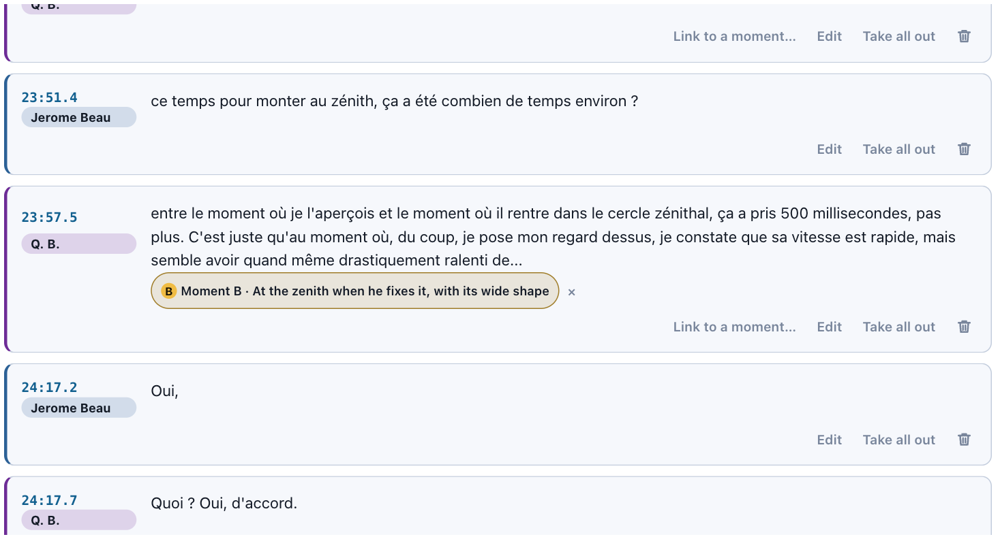
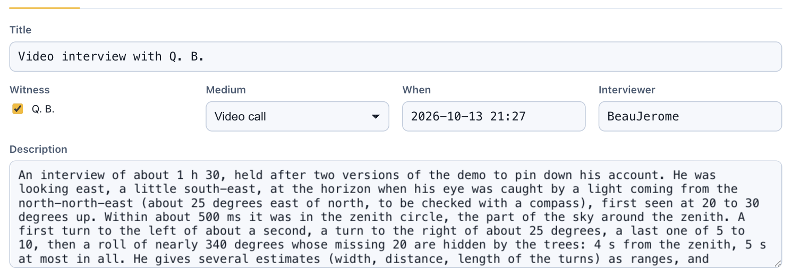
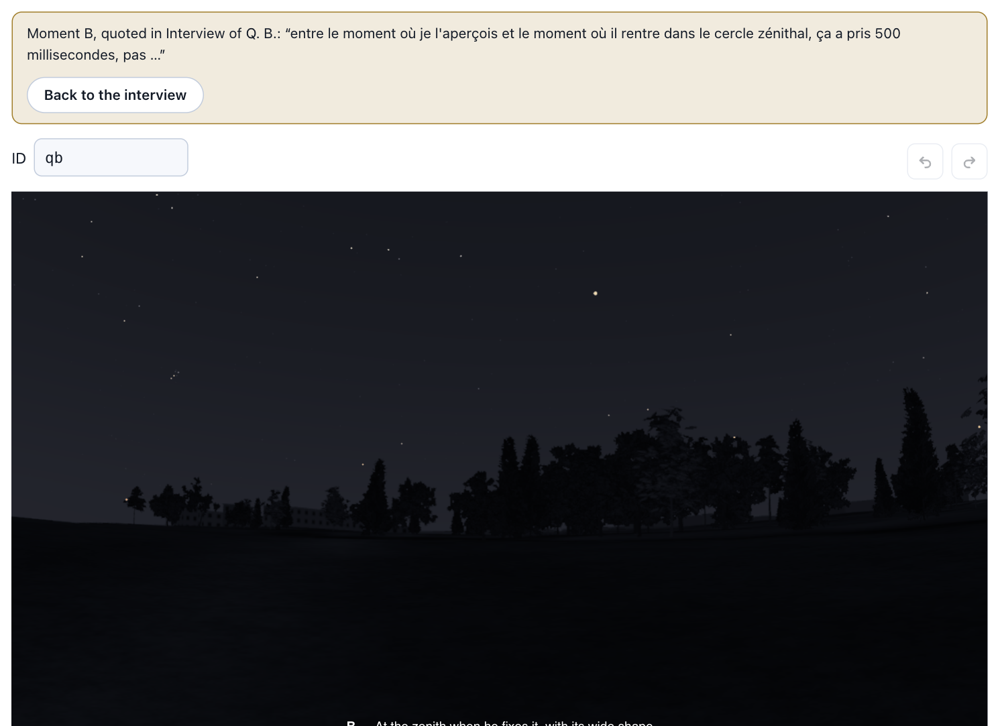
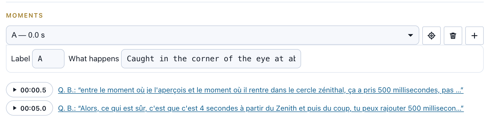
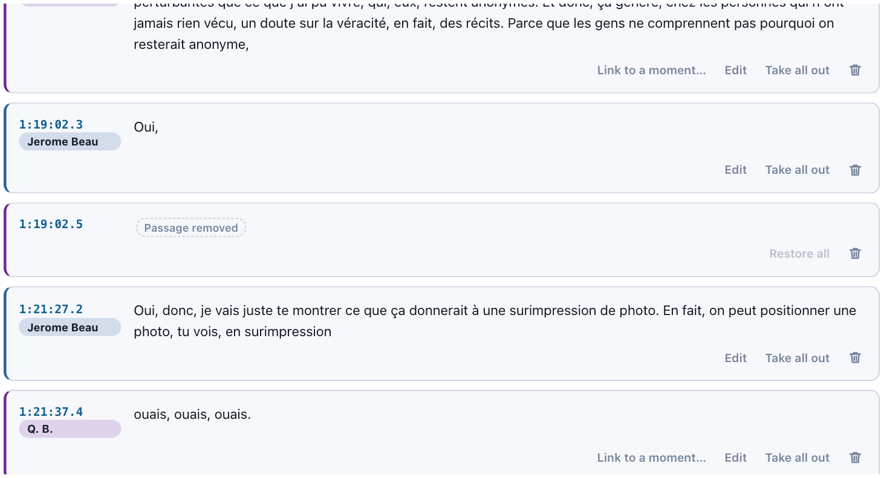

# What the witness said, and where it shows

*Interviews in UFO@home, linked to the moments they tell of*

*Saint-Lô (France), interview of 13 October 2026: the witness’s words about the first half second, and the moment of the observation they are about.*

In the previous articles of this series I presented [UFO@home](https://ufoathome.org/), a tool that replays a UFO sighting against the real sky of its date and place (why), the model a reconstruction is made of, and how it is built. This one is about a part of an investigation that usually stays in the investigator’s drawers: **the interview**.

## Why keep the interview

An investigator rarely stops at a witness’s first account. They go back to the witness, to fix a figure, to ask what was not said, to check what does not add up. That conversation is often where the account takes its final shape, and it is also where the doubts, the hesitations and the corrections are heard.

Yet what usually reaches the reader is the conclusion: “the witness estimated the duration at four seconds”. Not the question that was asked, not the answer as it was given, not what it corrected. As I wrote in an [older article](https://medium.com/@rr0/enqu%C3%AAtes-mal-enlev%C3%A9es-e27f6a5ad26), an investigation can only be reviewed if its raw data is shared. An interview is raw data.

So in UFO@home, an interview is an **event of the case**, next to the observations and their interpretations (see the model). What the case keeps of it is what it established, a short description, and, when there is one, its **transcript**: who said what, and when. The transcript is what a reader can check the description against.

The example used throughout this article is the [Saint-Lô](https://ufoathome.org/play/?file=%2Fdemo-data%2Fcase-saint-lo.json) case: a moonless night of August 2026 in Normandy, where a witness, Q. B., saw a translucent white shape cross the whole sky in a few seconds. Q. B. first answered questions in writing on a mailing list, then I held a video interview of about an hour and a half with them, on 13 October 2026.

*The interview as an event of the case: whom it was held with, how, when, by whom, and what it established.*

## From the interview to the observation

Nothing of an interview is replayed: the observation is what is replayed, and the interview is what explains its figures. But the two are linked, **both ways**.

A turn of the transcript can say which **moment of the observation** it tells of. In the Saint-Lô interview, Q. B. says that it took “500 milliseconds, no more” for the phenomenon to reach the zenith. That turn is linked to moment B of the observation, the instant the witness’s eyes caught up with it, at the zenith. The link shows in the transcript under the turn, named after the moment rather than its time (first picture of this article).

Following it opens the observation **at that moment**, with what was said there and the way back:

*From the interview to the observation: the sky of Saint-Lô at the instant the witness is talking about, and the way back to the turn.*

## From the observation to the interview

The other way round, each moment of the observation lists the passages of the case’s interviews that tell of it. Whoever looks at a moment of the reconstruction sees at once that the witness was asked about it, and what they said:

*Under the moments of the observation, the passages of the interview that tell of them, each a link back to the turn.*

The same pair exists outside the editor. A page can show an interview with the \<rr0-interview> element next to a reconstruction: a passage followed to its moment then shows the observation there, at that moment, in the same page.

## The interview as a source of the observation

There is a third link, maybe the most important one. An interview is not only *about* the observation: it is a **source** of its data. In UFO@home every value of a recording can say what it stands on (see the model): stated by the witness, measured, derived or assumed, with its reasoning. In the Saint-Lô recording, many values give the call as their source, quoting the witness’s own words:

![The basis window of the heading of the witness's gaze: basis "stated", and the rationale "call of 2026-10-13: 'je regardais [...] est, sud-est, mais légèrement' (the written reply said west-south-west; his friend was the one looking west)"](img4/value-from-interview.png)
*The heading the witness was looking towards, as given in the interview, and why it differs from the written reply.*

This is where an interview earns its keep. In writing, Q. B. had said they were looking west-south-west; asked about it on the call, they answered east-south-east, and explained that the friend with them was the one looking west. In writing, the whole sighting had lasted six seconds at most; on the call, “four seconds from the zenith”, “4.5, 5 seconds at most” in all. Both values in the recording are the interview’s, and both say so. The interview itself is listed among the recording’s sources, next to the messages of the mailing list.

## Taking passages out

A transcript of an hour and a half holds much more than the sighting: a private life, names, the places someone lives or works, the exact spot of the observation. Publishing everything is out of the question; cutting silently would make the transcript unverifiable, since a reader could no longer tell what was said from what was removed.

So in UFO@home, **what is taken out keeps its place**: the turn stays where it was, with its time, and says **why** it was removed. In the Saint-Lô interview, 65 whole turns are taken out, for two reasons: private life (personal background, family, named third parties), and details that would identify the witness, with the end of the call.

When only a detail has to go, only that stretch is taken out, with a reason of its own. Asked whether there were lights in the park, Q. B. answered that there were none: that answer stays, while what followed it goes, as “details of the exact place of the observation (the witness does not want it public)”.

*A stretch taken out of an answer, the rest kept: the mark says that something was removed, and its tooltip says why.*

Whole turns taken out show as a single gap, with no speaker named, since the gap may hide an exchange:

*A whole turn taken out: a gap, its time, and its reason.*

The editor does this on the transcript itself: a selection of text can be taken out with its reason, a whole turn too (“Take all out”), and a passage removed during the session can be restored. First names can also be replaced by a marker throughout, as they are in Saint-Lô.

## Who approved it

One last thing a transcript has to say is whether the people who spoke in it agree with what it makes them say. Each speaker has an approval status: *pending* (not asked yet, or no answer), *approved*, or *covered*, for a file that holds less than a version the speaker already approved (passages removed, nothing added). A speaker who is not listed has not approved.

The Saint-Lô transcript says, honestly, that neither the witness nor the interviewer has approved it yet. That is not a detail: a reader quoting it knows they are quoting a draft.

## Transcripts from elsewhere

Most transcripts are not born in UFO@home. The editor reads the formats recording tools and subtitle editors write (WebVTT, SRT), and plain text or Markdown with a speaker’s name before each turn (“Name: …”, “[00:12:34] Name: …”, “Q: / A:”). It matches the names it finds with the people of the case (an interviewer, a witness), marks every turn as pending approval, and says what file it came from. It guesses, and says so: what it gets wrong is corrected by hand.

## Conclusion

An interview in UFO@home is not an appendix to an investigation, it is part of its data:

- it is an **event of the case**, with its date, medium, interviewers and what it established, and its transcript;
- its turns are **linked to the moments** of the observation they tell of, and each moment lists the passages about it: **both ways**, in the editor and on a published page;
- it is a **source** of the observation’s values, which quote it, and it can correct what was written before;
- what is **taken out** keeps its place and its reason, down to a few words in an answer;
- each speaker’s **approval** is stated, so that a draft reads as a draft.

The last article of this series will be about the part everybody asks about: how **AI** can help turn an account into a recording (AI, optional).
