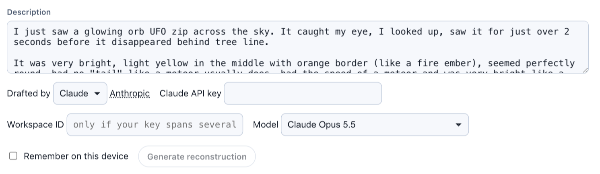

# AI writes the account, never the sky

*How UFO@home uses AI, and why it is optional*

*Mission Viejo (California), 2026: an account posted on X, in the witness’s own words, ready to be drafted into a recording. The key is the author’s own, and stays in their browser.*

This is the last article of a series on [UFO@home](https://ufoathome.org/), a tool that replays a UFO sighting against the real sky of its date and place. The previous ones said why, described the model a reconstruction is made of, how it is built, and how interviews fit in. This one answers the question everybody asks first: what about AI?

## Why not ask an AI to do it all?

It is tempting. Ask a model for “a scene of what this witness saw”, and it will write a 3D scene, or paint a video, that looks right: a sky, a field, a light.

But that would be an **illustration**. Whether the Moon was really up, where the Sun really was, what the cloud cover was that morning, how big the thing really looked from where the witness stood: each of those is something the model may have got right, and nothing in the result says which. It would also be a one-off: a thousand lines of code nobody has checked, written differently for the next case, which cannot be laid beside the next case.

A UFO@home recording splits the work the other way:

- **what an AI may write is only the account**: a date, a place, directions and apparent sizes over time, each value marked as stated, derived or assumed (see the model);
- **the sky, the weather on record, the ground, the optics** of the eye or the camera are computed from that account by the same engine for every case, tested, and public (see how it is built).

The format’s limits are part of the point. It has no field for a real size or a distance, so an assistant cannot slip a conclusion in among the facts. And what it writes is a short file that anyone can read, replay, correct, and show the witness.

## Three ways to write a recording, one result

A recording can be made in three ways, and all three give the same thing: a JSON file that belongs to its author, and that anybody can replay.

1. **In the editor**, by hand: draw what was seen, say when and where, record how it moved. This is the ordinary way, and nothing in it needs AI.
2. **With an AI assistant**, from a case file.
3. **By hand or by program**, from a text editor or an existing database: the format is documented field by field, with its schema.

AI is one way among three, never a requirement: the player reads a file however it was made.

## From a case file, with an assistant

When a case already has its documents (a report, a questionnaire, a statement, sketches, photographs of the place, a map), the quickest way is often to hand them to an AI assistant that can read PDFs and images and run a little code, point it at the documentation, and have it write the file. It reads the account, measures the drawings, computes directions from the map, and writes what it found in the format.

The assistant knows nothing about the case but what it is given, and nothing about the format but what the documentation says. So it has to be asked for the discipline an investigator would keep:

*What to ask of an assistant: the same rules a careful investigator follows, written as a prompt.*

Two lines of that prompt matter most. **“State only what the documents support”**, with every value worked out marked as derived, with its working, and every value chosen marked as assumed. And **“list the contradictions between the documents, and the questions to put back to the witness or the investigator”**: an assistant is good at noticing that a report says north-east and a sketch says east, and it should say so rather than pick one.

The same instructions are packaged as a **skill** for Claude: the method, the format’s rules, the schema, an example and a validator that needs only Python, so that only the documents have to be handed over.

Does it work? On a case of the GEIPAN, the French official UFO office, an assistant given only the public file and the documentation produced a recording whose phenomenon matched the one made by hand **to within a tenth of a degree**.

## From the witness’s own words, in the editor

A witness who only has their own account can draft from it inside the editor: type it in the Summary group, choose what drafts it (Claude today, with the author’s own API key and the model of their choice), and the editor drafts the rest of the recording from it (first picture of this article). The draft is a **proposal** that the author edits, never a result.

Nothing goes through ufoathome.org: the text is sent from the browser to the chosen model, with the author’s key, only when they ask. The key is kept in the browser only if they tick “Remember on this device”, and forgotten as soon as they untick it.

## Checking what it wrote

An assistant can be wrong with confidence. The file is only as good as the documents behind it and the checking after it. So what it writes is checked the way a colleague’s work would be:

- **play it**: is the phenomenon where the drawings put it, against the right trees, at the right height above the horizon? Say what is off, and have it corrected;
- **read the assumed values**: they are the list of what nobody said. Each is a question for the witness, or a place where the reconstruction stands on a guess;
- **finish in the editor** what is easier with a mouse than with a sentence: moving a building by a few metres, nudging a direction until it sits on a photograph;
- **show it to the witness**: the only test that counts is whether they recognise what they saw.

This is where the format pays off. Because every value carries its basis, a draft cannot hide what it guessed. And because the scene is computed, not drawn, a wrong date or a wrong heading shows at once as a wrong sky.

## Privacy, again

An account is personal data. Before handing documents to an online assistant, what identifies the witness has to be removed, unless they agreed to it, and what the service keeps has to be checked. UFO@home itself keeps nothing: no account, no server storing anything, and a key that never leaves the author’s browser (see the privacy part of the model, and what interviews take out).

## Conclusion

AI has a place in UFO@home, and a bounded one:

- it may write **the account**, from documents or from the witness’s words, never the sky, the weather or the ground, which are computed;
- the format leaves it **no room for a conclusion**: angles only, and every value marked as stated, derived or assumed;
- it is asked to **list contradictions and questions**, not to settle them;
- it is **optional**: the editor, a text editor or a database produce the same file;
- what it writes is **checked**: played, read for its assumptions, corrected, and shown to the witness.

This series is over, but the project is not. Everything it describes is free software, and the [demos](https://ufoathome.org/demos/) are the best place to start.
